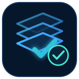
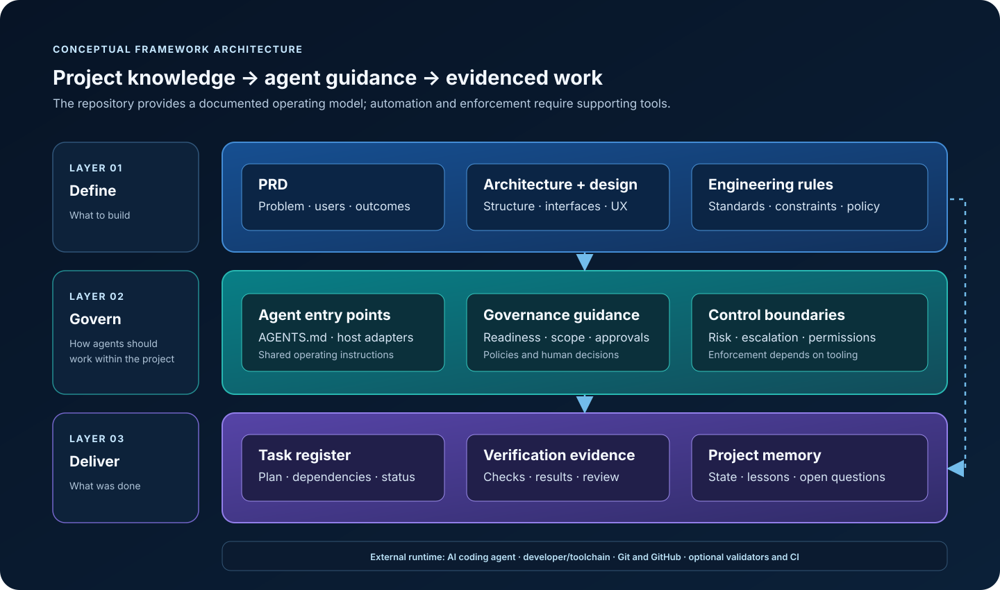
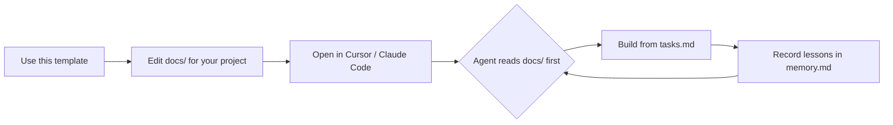
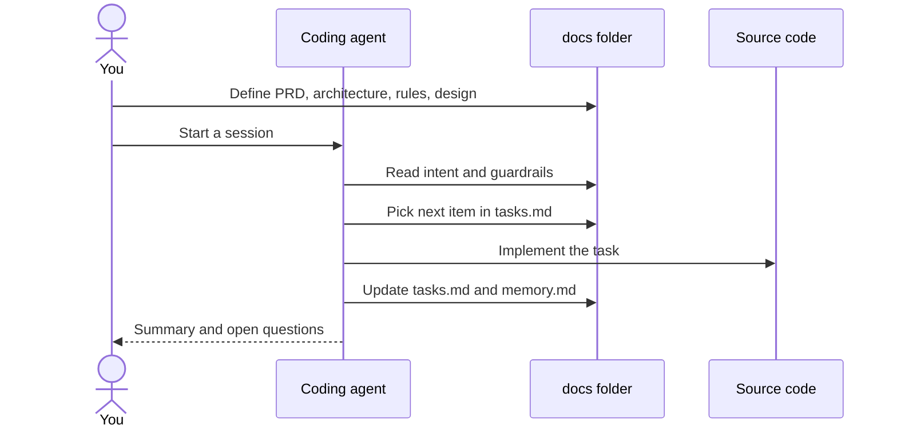

<p align="center">
  
</p>

# AI Agent–Driven Development Setup Template

<p align="center">
  
</p>

[](https://github.com/abhilash333naidu/AI_Project_Setup/releases) [](LICENSE) [](https://github.com/abhilash333naidu/AI_Project_Setup)

A minimal, opinionated starter template for vibe-coding and AI-agent-driven development. Use it to bootstrap new projects with a stable `docs/`-first workflow so your coding agent always has the right context.

## Who this is for

Solo developers who want to ship faster with AI coding agents, without losing track of scope, architecture, or past decisions.

## Why this exists

AI coding agents work best when they have a clear blueprint. This template separates **thinking and guardrails** from **source code**, so your agent reads intent first and stays aligned across sessions.

## What's inside

- `docs/`: the core docs layer
  - `prd.md`: product requirements and scope
  - `architecture.md`: system architecture and tech stack
  - `rules.md`: coding rules and agent guardrails
  - `design.md`: UI/UX design tokens and decisions
  - `tasks.md`: executable task checklist
  - `memory.md`: lessons learned and session memory
- `AGENTS.md`: canonical agent instructions (read `docs/` first, verify before ticking tasks, stop-and-ask gates). Read natively by Cursor, OpenCode, Codex, Kilo and others; Claude Code loads it via `CLAUDE.md`
- `CLAUDE.md`: one-line import of `AGENTS.md` for Claude Code
- `.cursorrules`: legacy Cursor pointer to `AGENTS.md`
- `examples/tinytodo/`: a fully filled-in `docs/` set showing what good looks like
- `.github/ISSUE_TEMPLATE`: standard feedback issue template
- `.gitignore`: sensible defaults for common stacks
- `LICENSE`: MIT license

<p align="center">
  
</p>

The diagram shows the documented operating model. Enforcement depends on your agent and tooling; the template itself does not block agents.

## How it works





Your `docs/` folder is the source of intent. The agent reads it before writing code, so scope, architecture, and rules stay consistent across sessions.

Every doc starts with `Status: draft`. Agents refuse to write code until you flip each to `ready`.

## Quick start

1. Click **Use this template** on GitHub, or scaffold from the terminal (works on Windows, macOS, Linux):

```bash
npx degit abhilash333naidu/AI_Project_Setup my-ai-project
cd my-ai-project
git init
```

`degit` copies the files without the template's git history. No `rm -rf .git` needed.

2. Edit each file in `docs/` for your project.
3. Set `Status: ready` at the top of `prd.md`, `architecture.md`, `design.md` and `rules.md` once filled.
4. Open the project in Cursor, Claude Code, or your preferred agent host.
5. Start coding. The agent reads `AGENTS.md` and `docs/` first, verifies each task before ticking it, and keeps `tasks.md` and `memory.md` current.

## Download ZIP

Download `AI_Project_Setup_template.zip` from the [v1.1.0 release](https://github.com/abhilash333naidu/AI_Project_Setup/releases/tag/v1.1.0), or click **Use this template** above.

## Contributing

Open an issue using the feedback template. Useful feedback includes:
- What was missing when you started using it
- Which docs file was unclear
- What automation would have helped

## License

MIT. See [LICENSE](LICENSE).
